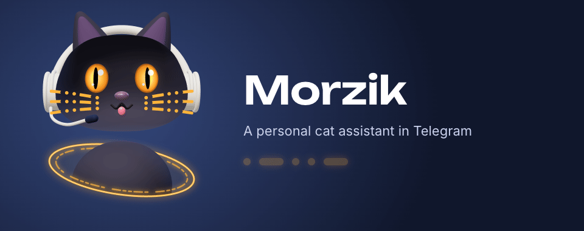
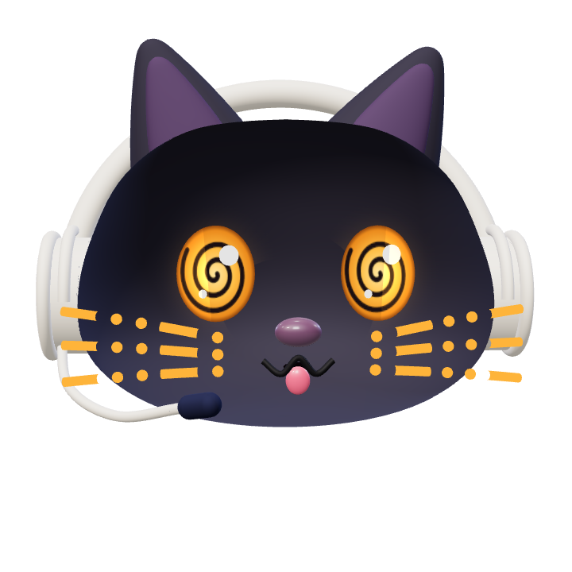

<div align="center">



**A personal cat assistant in Telegram.** Murzik (a classic Russian cat name) + Morse.

Mail, reminders, calendar and small errands, in a chat, like texting a friend.<br>
Big jobs go to coding agents on the computer.

<sub>· – · · –</sub>

</div>

---

## What he's like

A black house cat in a matte headset. He talks plainly, without officialese or exclamation marks, writes short messages, one thought per message. Looks like a simpleton, forgets nothing.

He speaks Russian; here is a typical exchange in English:

```
Me:      more detail, what's up?
Morzik:  sec, looking
Morzik:  the domain payment of $9.99 didn't go through, that's the fourth reminder
Morzik:  will you pay in the dashboard, or should I remind you tonight?
```

## What he can do

|   |   |
|---|---|
| ✉️ **Mail** | Sees every new email right away and decides himself what to mention and what to quietly mark as read. |
| 📅 **Calendar and Reminders** | Works with the native Apple Calendar and Reminders on the Mac through his own bridge. |
| 🧭 **Helm** | Hands code, projects and long research to agents in Helm on the computer. |
| 📰 **Long answers** | Doesn't dump guides and write-ups into the chat: publishes them as a Telegraph article and sends the link. |
| 🎙 **Voice** | Understands voice messages and can answer by voice. |
| 🐾 **Speaks first** | Notices what matters and writes without being asked; offers to turn recurring things into scheduled tasks. |

## The app



The «Morzik» button left of the message field opens his full-screen app. For now it's a «Coming soon» screen with Morzik's head, eyes spinning from all the plans. Features that outgrow the chat will move here.

**[morzik.pieces.run](https://morzik.pieces.run)**

<br clear="right">

## What he's made of

| Part | Where | What it is |
|---|---|---|
| Brain | [Hermes Agent](https://github.com/NousResearch/hermes-agent) on the home server (`sketch-server`) | Model, memory, tools, scheduling, Telegram, his own browser |
| Character | `~/.hermes/SOUL.md` | How he talks and behaves |
| Chat manners | `~/.hermes/plugins/morzik-chat` | Splitting replies into messages, «typing…» only when it fits, «sec» before a lookup, `/restart`, `/clean` |
| Apple | [`bridge/`](bridge) | MCP server in Swift for Calendar and Reminders |
| Looks | [`design/`](design) | three.js 3D model, design canvases with variants, avatar rendering |
| App | [`webapp/`](webapp) | Telegram Mini App on [pieces.run](https://pieces.run) |

The bot itself, with its keys and tokens, lives in `~/.hermes` of the `morzik` user on the home server and is not part of this repository; the Calendar and Reminders bridge and Semafor stay on the Mac.

## In this repository

```
bridge/        Morzik Bridge: Apple Calendar and Reminders over MCP
design/
  avatar/      animated avatar render (MP4, GIF, PNG)
  canvas/      design canvases: picking the character, an app instead of a menu, the login screen
  readme/      the banner at the top of this page
greeter/       jokes for the login screen
voice/         latency bench for the voice endpoint
webapp/
  public/      the app page and the head video with a transparent background
  render/      rendering that video from the 3D model
docs/notes.md  how everything is built and configured, in detail
```

Details on each part, rebuild commands and settings are in **[docs/notes.md](docs/notes.md)** (in Russian).

<div align="center"><sub>🐈‍⬛</sub></div>
