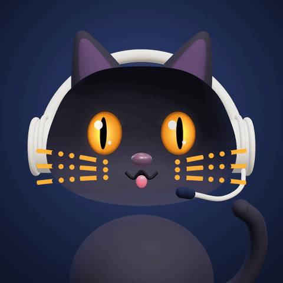

<div align="center">



# Морзик

**Личный кот-помощник в Telegram.** Мурзик + Морзе.

Почта, напоминания, календарь и мелкие дела — в чате, как с другом.<br>
Большую работу он передаёт агентам на компьютере.

<sub>· – · · –</sub>

</div>

---

## Какой он

Чёрный домашний кот в матовой гарнитуре. Говорит просто, без канцелярита и восклицательных знаков, пишет коротко и по одной мысли в сообщении. С виду простачок, на деле ничего не забывает.

```
Пользователь:  поподробнее, че там?
Морзик:  ща гляну
Морзик:  не прошёл счёт за домен на $9.99, напоминают уже четвёртый раз
Морзик:  оплатишь в кабинете или напомнить вечером?
```

## Что умеет

|   |   |
|---|---|
| ✉️ **Почта** | Видит каждое новое письмо сразу, сам решает, о чём сказать, а что тихо пометить прочитанным. |
| 📅 **Календарь и Напоминания** | Работает с нативными Календарём и Напоминаниями Apple на Маке через свой мост. |
| 🧭 **Helm** | Код, проекты и долгие исследования передаёт агентам в Helm на компьютере. |
| 📰 **Длинные ответы** | Инструкции и разборы не вываливает в чат, а публикует статьёй Telegraph и присылает ссылку. |
| 🎙 **Голосовые** | Понимает голосовые и может ответить голосом. |
| 🐾 **Сам первым** | Замечает важное и пишет без запроса; повторяющееся предлагает сделать задачей по расписанию. |

## Приложение


Кнопка «Морзик» слева от поля ввода открывает его приложение на весь экран. Сейчас там экран «Скоро» с головой Морзика, у которой от всех планов глаза крутятся спиральками. Сюда будут переезжать функции, которым тесно в чате.

**[morzik.pieces.run](https://morzik.pieces.run)**

<br clear="right">

## Из чего сделан

| Часть | Где | Что это |
|---|---|---|
| Мозг | [Hermes Agent](https://github.com/NousResearch/hermes-agent) на Маке | Модель, память, инструменты, расписание, Telegram |
| Характер | `~/.hermes/SOUL.md` | Как говорит и как себя ведёт |
| Манеры в чате | `~/.hermes/plugins/morzik-chat` | Разбивка на сообщения, «печатает…» по делу, «ща» перед поиском, `/restart`, `/clean` |
| Apple | [`bridge/`](bridge) | MCP-сервер на Swift для Календаря и Напоминаний |
| Внешность | [`design/`](design) | 3D-модель на three.js, холсты с вариантами, рендер аватарки |
| Приложение | [`webapp/`](webapp) | Telegram Mini App на [pieces.run](https://pieces.run) |

Сам бот с ключами и токенами живёт в `~/.hermes` и в репозиторий не входит.

## Внутри репозитория

```
bridge/        Morzik Bridge — Календарь и Напоминания Apple по MCP
design/
  avatar/      рендер анимированной аватарки (MP4, GIF, PNG)
  canvas/      холсты: выбор персонажа, приложение вместо меню
webapp/
  public/      страница приложения и видео головы с прозрачным фоном
  render/      рендер этого видео из 3D-модели
docs/notes.md  подробно, как всё устроено и настроено
```

Подробности по каждой части, командам пересборки и настройкам — в **[docs/notes.md](docs/notes.md)**.

<div align="center"><sub>🐈‍⬛</sub></div>
